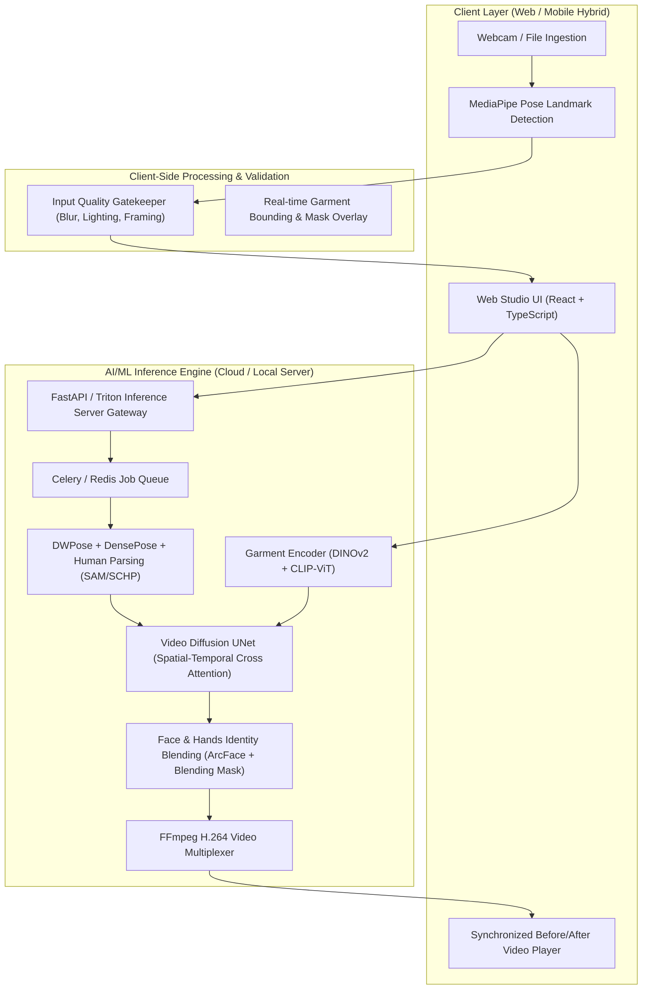

# 📐 Architecture Specification: Ardobe AI (Video & Photo Virtual Try-On)

> **Project Name**: Ardobe AI (Motion Wardrobe & Virtual Try-On Studio)  
> **Status**: In Conception & Initial Scaffolding  
> **Version**: 1.0.0-alpha  

---

## 1. System Topology & End-to-End Flow



---

## 2. Component & Code Map Table

| Modul / Komponen | File Target | Tanggung Jawab / Fitur | Dependensi |
| :--- | :--- | :--- | :--- |
| **Global State & Session** | `src/context/TryOnContext.tsx` | State manajemen video input, wardrobe item, status render, progress bar | React Context |
| **Design System & Styling** | `src/styles/theme.css`, `src/App.css` | Color tokens, glassmorphism, responsive grid, dynamic animations | Vanilla CSS |
| **Webcam & Video Ingest** | `src/components/CaptureStudio.tsx` | Perekam video webcam 5-10 detik, upload drag-and-drop, validasi durasi & aspect ratio | MediaRecorder API |
| **Pose Guidance Overlay** | `src/components/PoseOverlay.tsx` | Visual silhouette & pedoman posisi tubuh pengguna agar hasil inpainting presisi | Canvas 2D / SVG |
| **Wardrobe Catalog Selector**| `src/components/WardrobePicker.tsx` | Koleksi pakaian sampel (Hoodie, Abaya, Jacket, Casual Tee, Dress) + Custom Upload | Image loader |
| **Video Try-On Player** | `src/components/VideoComparisonPlayer.tsx`| Synchronized side-by-side dan split-screen slider untuk video asli vs video try-on | HTML5 Video API |
| **Inference Orchestrator** | `src/services/inferenceService.ts` | Endpoint mock/real worker dengan WebSocket & SSE progress updates | Fetch / WebSocket |
| **Model Specification Specs**| `docs/model_pipeline_specs.md` | Arsitektur model AI: IDM-VTON, AnimateAnyone, DensePose, dan loss functions | Markdown Specs |

---

## 3. Key Data Contracts

### A. Garment Payload Contract (`GarmentItem`)
```typescript
export interface GarmentItem {
  id: string;
  name: string;
  category: 'tops' | 'bottoms' | 'outerwear' | 'fullbody' | 'abaya_thobe';
  thumbnailUrl: string;
  hdGarmentUrl: string;
  fabricType?: string;
  metadata?: {
    fitType: 'loose' | 'regular' | 'slim';
    genderTarget: 'unisex' | 'mens' | 'womens';
  };
}
```

### B. Video Inference Job Contract (`TryOnJob`)
```typescript
export interface TryOnJobRequest {
  videoSourceUrl: string; // Base64 or Object URL
  garmentId: string;
  targetResolution: '720p' | '1080p';
  preserveFaceAndSkin: boolean;
  temporalSmoothingStrength: number; // 0.0 - 1.0
  fps: number; // default 24
}

export interface TryOnJobResponse {
  jobId: string;
  status: 'queued' | 'preprocessing' | 'pose_tracking' | 'diffusion_generating' | 'completed' | 'failed';
  progressPercentage: number;
  outputVideoUrl?: string;
  elapsedSeconds: number;
  error?: string;
}
```

---

## 4. Failure Modes & Fallbacks

| Skenario Kegagalan | Dampak | Penanganan Fallback |
| :--- | :--- | :--- |
| **Pencahayaan Video Terlalu Gelap** | Pose detector meleset, inpainting berbayang | Sistem mendeteksi histogram luminance video; tampilkan peringatan *"Pencahayaan kurang terang"* sebelum proses render dimulai. |
| **Gerakan Kamera Goyang Ekstrem** | Flickering dan deformasi baju antar frame | Fitur auto video stabilization atau ekstraksi pose per-frame dengan Kalman filtering. |
| **Koneksi Jaringan Terputus saat Render** | Status job hilang | Job ID disimpan di `localStorage` dengan polling resume saat koneksi pulih. |
| **GPU Out Of Memory (OOM) pada 1080p** | Worker cloud crash | Auto-fallback ke batch resolution 720p 24fps dengan model quantization FP16/INT8. |
